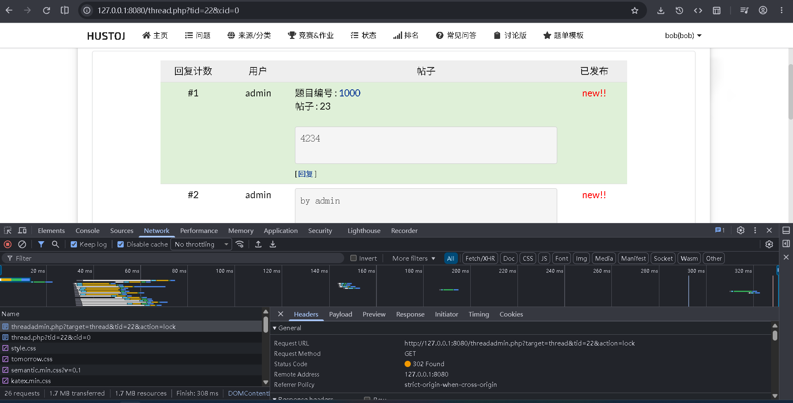
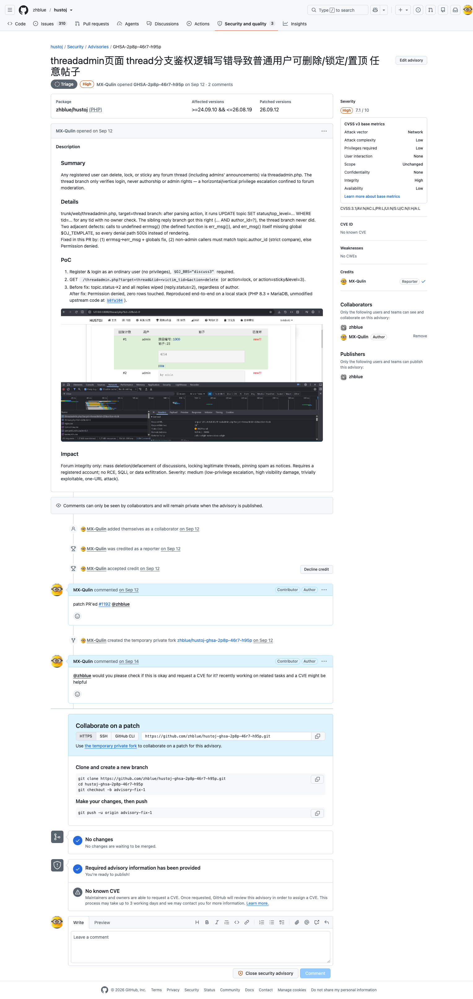

# Missing authorization in `threadadmin.php` (zhblue/hustoj)

**GHSA-2p8p-46r7-h95p** · CVSS 3.1 **7.1 (High)** · CVE requested, not yet assigned


## Prerequisites

Forum enabled: `$OJ_BBS="discuss3"`. 

Attacker account: any registered user, no privileges needed. 

Vulnerable range: `>= 24.09.10 && <= 26.08.19`. 

commit before or is: `b8fa104`.

## Root cause

`trunk/web/threadadmin.php` (`target=thread` branch) is the thread moderation endpoint. It takes the target thread and the action from the request (`/threadadmin.php?target=thread&tid=<tid>&action=delete|lock|resume|sticky&level=<0-3>`), and its only check is login state:

```php
if (!isset($_SESSION[$OJ_NAME . '_' . 'administrator']) && !isset($_SESSION[$OJ_NAME . '_' . 'user_id']))
    errmsg(...);
```

That condition stops the request only when the caller is neither an administrator nor logged in, so every authenticated user passes. 

Nothing compares `topic.author_id` against the session, nothing requires admin rights. 

The sibling `target=reply` branch in the same file does this correctly (`WHERE rid=? AND author_id=?`), which confirms the omission is a bug, not a design choice.

 Since `tid` is auto-increment, an attacker walks `tid=1..N` and empties the board: `delete` sets `topic.status=2` and wipes all replies (`UPDATE reply SET status=2 WHERE topic_id=<tid>`), `lock` sets `status=1`, `sticky&level=3` sets `top_level=3`, rendering the thread as a site-wide administrator notice. 

Two adjacent defects: denial paths call undefined `errmsg()` (the real function is `err_msg()`), and `err_msg()` lacks `global $OJ_TEMPLATE`, so every denial returns HTTP 500 instead of an error.

## Status

verified on PHP 8.3 + MariaDB at `b8fa104`. 

Fixed in `26.09.12` via [PR #1192](https://github.com/zhblue/hustoj/pull/1192) (commits `ebe4f6880`, `9644d29e`): non-admin callers must match `topic.author_id` or get `Permission denied.`. 

Fix verified by re-running the same PoC against the patched build.

## PoC

One request, logged in as an ordinary user: `GET /threadadmin.php?target=thread&tid=22&action=lock` returns 302 and locks a thread authored by `admin`:




Automated, zero dependencies: `python3 poc.py --url http://127.0.0.1:8080/ --auto-register` runs sticky, lock, delete, and denial-path checks; vulnerable builds report `VULNERABLE` on all four, patched builds report `patched`.


## Reported triage:



Repo owner didn’t repond to this advirsory, the fix PR has been merged.

References: [GHSA-2p8p-46r7-h95p](https://github.com/zhblue/hustoj/security/advisories/GHSA-2p8p-46r7-h95p), [PR #1192](https://github.com/zhblue/hustoj/pull/1192), [threadadmin.php](https://github.com/zhblue/hustoj/blob/master/trunk/web/threadadmin.php). 

Reported by [MX-Qulin](https://github.com/MX-Qulin) on 2026-09-12.
